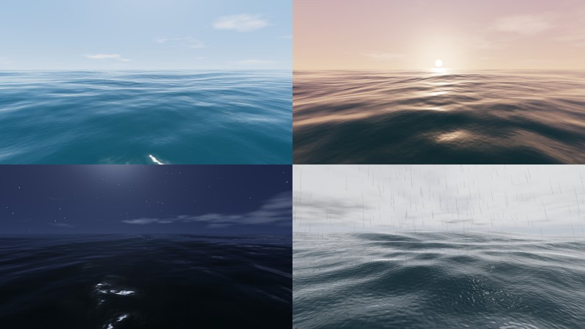

# Oceano

Um app do HyperXR em que a sua sala afunda e vira mar aberto. Fica na biblioteca, em Jogos e
experiências, com o ícone de onda.

A prévia acima foi renderizada com os shaders do app (WebGL2 no Chromium, sem celular). Mostra
dia, pôr do sol, noite com lua e tempestade com chuva.

## Como funciona

1. **Medir a sala.** Enquanto a sala ainda está lá (realidade mista), o sensor de profundidade do
   ARCore mapeia a sala conforme você olha em volta. Os pontos aparecem em cores falsas: quente é
   perto, frio é longe. Deles saem:
   - a altura do chão: pelos planos do ARCore (ligados só enquanto o Oceano está aberto; funcionam
     até sem o sensor de profundidade) ou, sem plano, pela camada horizontal mais densa de pontos
     bem abaixo dos olhos (um tampo de mesa não engana);
   - a distância das paredes;
   - a altura do teto.

   O menu mostra quantos pontos foram medidos e as distâncias.
2. **Afundar a sala.** A última foto da câmera é colocada sobre a profundidade da sala, formando
   uma cópia 3D do que você vê. Onde o sensor não mediu, valem o chão, o teto e as paredes
   medidos. Essa cópia desce devagar, por 7 segundos, e entra na água; a linha d'água fica com
   espuma. Em volta, o mar vai até o horizonte.
3. **Mar aberto.** Você fica um pouco acima da água. As suas mãos continuam rastreadas e
   desenhadas. "Voltar à sala" faz a sala subir de volta e a câmera reaparecer.

## Menu rápido (estilo painel rápido do Android)

- **Luz:** da noite (lua e estrelas) ao pôr do sol e ao meio-dia.
- **Volume:** controla o som do app.
- **Chuva:** gotas caindo em volta, gotas na superfície do mar e barulho de chuva.
- **Trovões:** raios com clarão no céu e no mar. O trovão chega depois do raio, atrasado pela
  distância (343 m/s). Raios perto estalam; raios longe só ribombam.
- **Mar agitado:** ondas altas e mais espuma.
- **Ver profundidade:** mostra ou esconde os pontos do sensor.
- **Medir de novo:** apaga a medição e recomeça.

Luz, volume, chuva, trovões e mar agitado ficam salvos para a próxima vez.

## O que está por trás

**Ondas:** 12 ondas de Gerstner com a relação de dispersão de águas profundas, então ondas mais
longas andam mais rápido. As cristas ficam pontudas e os vales largos, sem se dobrar. Perto de
você, as ondas longas são acalmadas para não passarem por cima dos olhos; as curtas continuam.

**Malha do mar:** uma malha radial em volta de você, com anéis de 3 cm no pé até centenas de
metros no horizonte. Cada onda some onde a malha fica grossa demais para ela, sem cintilar.

**Superfície do mar:**
- ondinhas de um mapa de normais que se repete sem emenda;
- reflexo do céu pelo Fresnel;
- luz atravessando as cristas;
- brilho do sol, que vira um caminho de luz perto do horizonte;
- espuma onde a crista quebra;
- névoa no horizonte.

**Céu:**
- cor pela altura do sol e disco do sol;
- nuvens que andam;
- estrelas à noite;
- o clarão dos raios.

O céu e o mar passam por tone mapping (ACES), como um filme.

**Som:** sintetizado na hora, sem gravações:
- mar: ruído grave em séries irregulares de ondas quebrando, com o chiado da espuma;
- chuva: ruído agudo com gotas;
- trovões: estalo mais um ribombo que rola.

**Testes:** ondas, raios, medição da sala, céu e som (níveis, sem estourar) têm testes no JVM
(`OceanModelTest`, `OceanSynthTest`). Os shaders compilam no WebGL2 (a mesma linguagem do GLES
3.0) e geram a prévia acima.

## Limites

- **Sem o sensor de profundidade do ARCore:** o chão vem dos planos do ARCore (ou da sua
  altura, 1,6 m, até achar um plano) e as paredes ficam a 2,6 m. A sala ainda afunda, mas a forma
  3D dela é aproximada.
- **Em VR (sem câmera):** não há sala para afundar; o mar aparece direto.
- **A foto da sala** cobre o campo de visão da câmera. Fora dele já é mar desde o começo.
- **Não testado no celular.** O desempenho real ainda não foi medido: mar e céu nos dois olhos
  pesam na GPU. A prévia acima foi gerada no PC.
